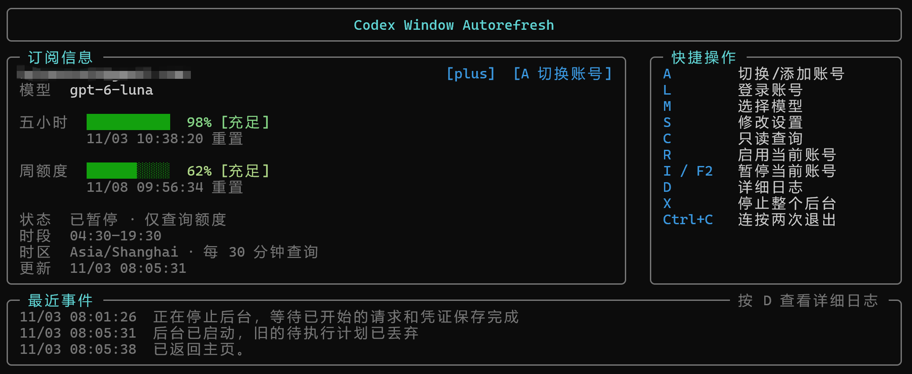

# Codex Window

[\[English\]](README.md) | [\[简体中文\]](README.zh-CN.md)

An automatic Codex subscription-window opener with multiple accounts, background operation and a terminal UI.

Checks usage during your configured hours and sends one `hello` only when the window is idle and quota permits, opening a new usage window.



## Download and run

Download a single executable from [Releases](https://github.com/HoloNova/codex-window/releases). Node.js is included; no installation or manual extraction is needed.

- **Windows 10/11 x64:** download and double-click `CodexWindow.exe` to open the TUI and keep the tray. The embedded core is automatically placed in your local cache. After closing the panel, use the tray to reopen it or exit the application.
- **Linux x64 (glibc, e.g. Ubuntu 22.04+):** download `codex-window` and run:

  ```sh
  chmod +x codex-window
  ./codex-window
  ```

No packages for macOS, ARM or Alpine/musl. Windows binaries are unsigned and may trigger security warnings.

## Get started

1. Press **L** to sign in.
2. Press **M** to select a model and **S** to set the time zone, operating hours and check interval.
3. Press **R** to enable the current account.

English is the default. Choose **S → Interface language → 简体中文** to switch to Chinese without affecting account operation.

Press **A** to add or switch accounts. Accounts run independently; new accounts start paused.

**Settings sync is on by default**, sharing the model, time zone, operating hours and check interval, but not enable/pause state. Turn it off in S to configure accounts separately. Saving pauses accounts whose configuration actually changes; enable them again when ready.

Click a menu item to select it, then press Enter to edit or confirm. In settings, ↑↓ wraps between the first and last items; Home/End jumps to either end. The subscription card shows the next locally scheduled action; opening a window still depends on current usage and settings when it runs.

## Shortcuts

| Key | Action |
| --- | --- |
| A | Add / switch accounts |
| L / M / S | Sign in / select model / settings |
| C | Check usage without sending |
| R | Enable the current account |
| I / F2 | Pause the current account |
| D | View logs |
| X | Pause all accounts and stop the backend |
| Esc | Go back |
| Ctrl+C twice (within 3 seconds) | Close the panel; the backend keeps running |

To exit the application, use **Exit application** in the Windows tray or `./codex-window quit` on Linux. Account enable/pause settings are preserved for the next launch.

## Notes

- Unofficial tool. It cannot reset an active window or increase quota; requests consume a small amount of quota.
- New sign-ins request only identity and offline-renewal scopes, without connector permissions. Existing grants are unchanged.
- Run only one scheduler per account, including other tools. Uncertain sends are not retried automatically.
- Data is stored in `~/.codex-window-node`, including plaintext credentials. Do not upload or share this directory.
- Before upgrading, fully exit the old application, then replace the executable. Very old versions without `quit` need `stop` instead; that pauses accounts.

Details: [Accounts](docs/MULTI_ACCOUNT.md) · [Configuration and scheduling](docs/CONFIG_AND_SCHEDULING.md) · [Distribution and tray](docs/DISTRIBUTION.md)

## Run from source

Requires Node.js 24+.

```sh
npm ci --ignore-scripts
npm run build
node dist/cli.js
```

Licenses are embedded in the executable; use `--license` to view them and `--version` for build information.

[MIT](LICENSE) · [Attribution](NOTICE.md)
