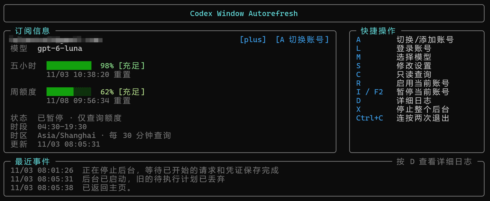

# Codex Window

[\[English\]](README.md) | [\[简体中文\]](README.zh-CN.md)

An automatic Codex subscription-window opener with multiple accounts, background operation and a terminal UI.

Monitors usage in the background and opens an idle window only during your configured hours, when quota permits.



## Download and run

Download a single executable from [Releases](https://github.com/HoloNova/codex-window/releases). Node.js is included; no installation or manual extraction is needed.

- **Windows 10/11 x64:** download and double-click `CodexWindow.exe`. It opens the panel and adds a system-tray icon. The embedded core is automatically placed in your local cache; no second download is needed. You can close the panel and keep using the tray and backend.
- **Linux x64 (glibc, e.g. Ubuntu 22.04+):** download `codex-window` and run:

  ```sh
  chmod +x codex-window
  ./codex-window
  ```

No packages for macOS, ARM or Alpine/musl. Windows binaries are unsigned and may trigger security warnings.

## Get started

1. Press **L** to sign in. Device-code sign-in copies the code to the system clipboard when a clipboard tool is available; the code stays visible and selectable, with a bottom-right confirmation. If copying is unavailable, the panel says so and leaves the code for manual selection.
2. Press **M** to select a model and **S** to set the time zone, operating hours and check interval.
3. Press **R** to enable the current account.

English is the default. Choose **S → Interface language → 简体中文** to switch to Chinese without affecting account operation.

Press **A** to add or switch accounts. Accounts run independently; new accounts start paused. Once enabled, you can close the panel: on Windows the tray and backend keep running, and **Open TUI** brings the panel back.

**Settings sync is on by default**, sharing the model, time zone, operating hours and check interval, but not enable/pause state. Turn it off in S to configure accounts separately. Saving pauses accounts whose configuration actually changes; enable them again when ready.

Click a menu item to select it, then press Enter to edit or confirm. In settings, ↑↓ wraps between the first and last items; Home/End jumps to either end.

Reopening the panel shows cached usage and the last successful check time; it does not add a query or reset a healthy backend's schedule. **Next action** distinguishes scheduled usage checks from planned openings, including an earlier check when one is due before an opening. Near reset, the backend checks again 90 seconds after reset and opens a window only if eligible. **D** shows automatic checks, opening plans and execution outcomes; uncertain sends are not retried.

When the panel starts, it makes one read-only request to the public GitHub Releases API. If a newer release exists, the title changes to **Codex Window Autorefresh · New version [Press U for releases]**. Press **U** on the home or log screen to open the Releases page in your browser. This only opens the page: it does not download, replace or run anything, and a failed check stays silent.

## Background operation

**On Windows, you do not need to keep the panel window open.** After configuring and enabling your accounts, close the panel; the tray and backend keep running, including scheduled checks and automatic openings. Double-click the tray icon or choose **Open TUI** to reopen the panel. Choose **Exit application** to close the tray, panel and backend safely.

On Linux, closing the panel also leaves the backend running. Use `./codex-window quit` to exit the application. **X** on either platform instead pauses all accounts and stops the backend.

## Opening mechanism

An opening command sends one short `hello` using your selected model, with no tools and `store: false`. Before sending, the app saves a pending outcome locally. A completed response is not proof that a window opened: a follow-up usage check confirms it. If the outcome is uncertain, the app keeps it pending and does not resend automatically, even after a restart. Review the account before pressing **R** to allow another attempt.

**Esc** returns to the previous view but cannot recall requests already sent. Credential saves already in progress finish safely. Operational logs show concise actions and outcomes rather than these implementation details.

## Shortcuts

| Key | Action |
| --- | --- |
| A | Add / switch accounts |
| L / M / S | Sign in / select model / settings |
| C | Check usage without sending |
| R | Enable the current account |
| I / F2 | Pause the current account |
| D | View logs |
| X | Pause all accounts and stop the backend |
| Esc | Go back |
| Ctrl+C twice (within 3 seconds) | Close the panel; the backend keeps running |

Exiting the application preserves account enable/pause settings for the next launch.

## Notes

- Unofficial tool. It cannot reset an active window or increase quota; requests consume a small amount of quota.
- New sign-ins request only identity and offline-renewal scopes, without connector permissions. Existing grants are unchanged.
- Run only one scheduler per account, including other tools. Uncertain sends are not retried automatically.
- Data is stored in `~/.codex-window-node`, including plaintext credentials. Do not upload or share this directory.
- The panel checks the public GitHub Releases API once per launch; this request contains no credentials. A failed check never blocks the panel or affects scheduling.
- Before upgrading, fully exit the old application, then replace the executable. Very old versions without `quit` need `stop` instead; that pauses accounts.

Details: [Accounts](docs/MULTI_ACCOUNT.md) · [Configuration and scheduling](docs/CONFIG_AND_SCHEDULING.md) · [Distribution and tray](docs/DISTRIBUTION.md)

## Run from source

Requires Node.js 24+.

```sh
npm ci --ignore-scripts
npm run build
node dist/cli.js
```

Licenses are embedded in the executable; use `--license` to view them and `--version` for build information.

[MIT](LICENSE) · [Attribution](NOTICE.md)
