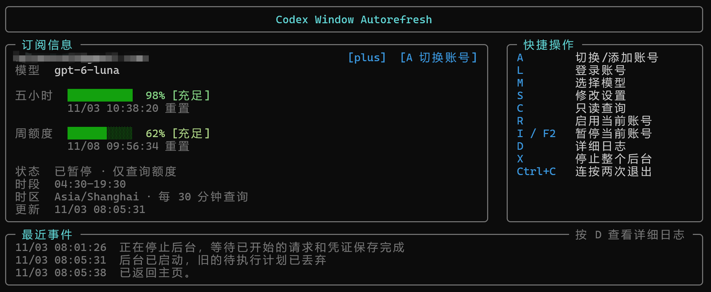

# Codex Window

[\[English\]](README.md) | [\[简体中文\]](README.zh-CN.md)

Codex 订阅窗口自动开启工具，支持多账户、后台运行和终端界面。

按设定时段检查额度，仅在窗口空闲且额度允许时发送一条 `hello`，开启新的额度窗口。



## 下载与运行

发行包统一通过 [Releases](https://github.com/HoloNova/codex-window/releases) 留存。自带 Node.js，无需额外安装。

- **Windows 10/11 x64**：完整解压，双击 `CodexWindow.exe` 直接打开 TUI；关闭面板后，可通过托盘重新打开或退出应用。同目录的 `codex-window-core.exe` 是主程序，请保留，无需单独运行。
- **Linux x64（glibc，如 Ubuntu 22.04+）**：解压后运行：

  ```sh
  chmod +x codex-window
  ./codex-window
  ```

暂不提供 macOS、ARM 或 Alpine/musl 安装包。Windows 预览包未签名，可能触发系统安全提示。

## 开始使用

1. 按 **L** 登录账号。
2. 按 **M** 选择模型，按 **S** 设置时区、运行时段和查询间隔。
3. 按 **R** 启用当前账号。

默认英文，可在 **S → Interface language → 简体中文** 切换语言，不影响账号运行。

按 **A** 添加或切换账号，各账号独立运行，新账号默认暂停。

**设置同步默认开启**，同步模型、时区、运行时段和查询间隔；启停状态保持独立。可在 S 关闭同步。保存后，配置实际变化的账号会暂停，需要重新启用。

设置支持 ↑↓ 首尾循环、Home/End 跳到首末项。订阅卡片显示本地计划中的下次动作，是否开窗仍取决于执行时的额度和设置。

## 快捷键

| 按键 | 操作 |
| --- | --- |
| A | 添加 / 切换账号 |
| L / M / S | 登录 / 选择模型 / 设置 |
| C | 查询额度，不发送 |
| R | 启用当前账号 |
| I / F2 | 暂停当前账号 |
| D | 查看日志 |
| X | 暂停全部账号并停止后台 |
| Esc | 返回上一步 |
| Ctrl+C 两次（3 秒内） | 退出面板，后台继续运行 |

完全退出应用：Windows 使用托盘的 **Exit application**；Linux 运行 `./codex-window quit`。账号启停设置会保留，下次启动沿用。

## 注意事项

- 非官方工具，不能重置已有窗口或增加额度；请求会消耗少量额度。
- 新登录已收窄授权范围，真实服务兼容性仍待验证；已有登录凭据和授权范围不变。
- 同一账号只启用一套调度器，避免与其他工具重复运行。发送结果不确定时不会自动重试。
- 数据保存在 `~/.codex-window-node`，凭据为明文存储。不要上传或分享数据目录。
- 更新旧版本前，先关闭面板并执行旧版的 `stop`，等待后台退出；升级后按需重新启用账号。

详细说明：[多账户](docs/MULTI_ACCOUNT.md) · [配置与调度](docs/CONFIG_AND_SCHEDULING.md) · [发行与托盘](docs/DISTRIBUTION.md)

## 源码运行

需要 Node.js 24+。

```sh
npm ci --ignore-scripts
npm run build
node dist/cli.js
```

[MIT](LICENSE) · [来源声明](NOTICE.md)
