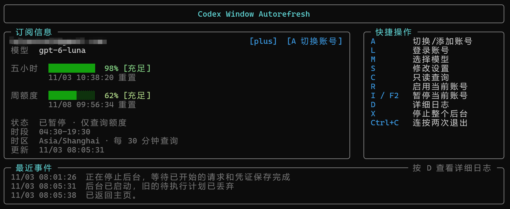

# Codex Window

[\[English\]](README.md) | [\[简体中文\]](README.zh-CN.md)

Codex 订阅窗口自动开启工具，支持多账户、后台运行和终端界面。

后台定时查询额度，仅在设定时段内、窗口空闲且额度允许时自动开窗。



## 下载与运行

从 [Releases](https://github.com/HoloNova/codex-window/releases) 下载单个可执行文件。自带 Node.js，无需安装或手工解压。

- **Windows 10/11 x64**：下载并双击 `CodexWindow.exe`，打开面板并显示系统托盘图标。内置核心会自动释放到用户缓存，无需再下载第二个文件。关闭面板后，托盘和后台仍可继续运行。
- **Linux x64（glibc，如 Ubuntu 22.04+）**：下载 `codex-window` 后运行：

  ```sh
  chmod +x codex-window
  ./codex-window
  ```

暂不提供 macOS、ARM 或 Alpine/musl 安装包。Windows 程序未签名，可能触发系统安全提示。

## 开始使用

1. 按 **L** 登录账号。设备码登录会在系统有可用剪切板工具时自动复制设备码；设备码仍保留在面板中可手动选中，右下角显示复制结果。若无法复制，会明确提示并保留设备码供手动选择。
2. 按 **M** 选择模型，按 **S** 设置时区、运行时段和查询间隔。间隔从上次查询完成时开始计算，不再对齐整点。
3. 按 **R** 启用当前账号。

默认英文，可在 **S → Interface language → 简体中文** 切换语言，不影响账号运行。

按 **A** 添加或切换账号，各账号独立运行，新账号默认暂停。启用账号后可以关闭面板：Windows 的托盘和后台会继续运行，选择 **打开面板** 即可恢复。

**设置同步默认开启**，同步模型、时区、运行时段和查询间隔；启停状态保持独立。可在 S 关闭同步。保存后，配置实际变化的账号会暂停，需要重新启用。

菜单可单击选中，再按 Enter 编辑或确认。设置支持 ↑↓ 首尾循环、Home/End 跳到首末项。

重新打开面板显示缓存额度和上次成功查询时间，不额外查询，也不重排正常运行的后台计划。**下次动作**显示后台安排的查询、开窗或结果确认。**C** 只查询，不发送、不新建任务，也不因查询跨过时间点就取消独立的重置检查或开窗确认；只有确认已开启新窗口时，才取消过时的重置计划。按 **D** 查看简洁的查询结果、计划变化和开窗结果；仅详细日志按类别配色，同时保留文字标签。

打开面板时会向公开的 GitHub Releases 接口发起一次只读检查。发现新版本时，标题变为 **Codex Window Autorefresh · 新版本 [按 U 跳转发布页]**。在首页或日志页按 **U** 会在浏览器中打开发布页；只打开页面，不下载、不替换、不执行任何文件，检查失败时保持静默。

## 后台运行

**Windows 不需要一直开启面板窗口。** 配置并启用账号后，可以关闭面板；托盘和后台仍会运行，继续定时查询及自动开窗。双击托盘图标，或选择 **打开面板 / Open TUI** 即可重新打开；选择 **退出应用 / Exit application** 才会安全关闭托盘、面板和后台。

Linux 关闭面板后，后台也会继续运行；使用 `./codex-window quit` 完全退出。两平台的 **X** 则是暂停全部账号并停止后台，与退出应用不同。

## 开窗机制

- 默认每 30 分钟常规查询一次。每次额度查询完成（包括手动、重置后、开窗确认和失败的查询尝试），都把常规查询推到完成时间加设定间隔；重置检查、开窗确认仍独立计时。
- 发现下一个间隔内会重置，就在**重置后 30 秒**重新查询，再决定是否开窗。
- 有效的重置时间距当前 **5 小时、容差 ±10 秒**，就按未开窗处理；普通自动查询发现空闲也可开窗。暂停、允许时段、模型和额度限制仍保留。用户刚开始工作可能仍落在容差内，接受偶尔多发一条短请求。
- 开窗指令使用选定模型发送一条简短的 `hello`，不启用工具，并设置 `store: false`。每次发送前先持久化占用次数。指令完成不等于成功；**结束后等 30 秒**，再查询确认。
- 新查询仍明确显示未开窗时，**最多补发一次**；补发结束后再等 30 秒查询。**一轮任务总计最多发送两次，重启也不重置次数。** 有效的活动窗口倒计时离开空闲容差范围，才确认开窗；已过期、不一致或查询失败的结果，不能当成功，也不能授权补发。
- 最终仍不明确时，保留待确认并继续常规只读查询，不重置补发次数。旧版本留下的待确认状态不会获得自动补发机会；暂停或控制／配置变化会撤销旧任务的补发许可。按 **R** 明确清除待确认、允许新尝试前，请先复核账号情况。

按 **Esc** 返回上一步不会撤回已发出的请求；已开始的凭据保存仍会安全完成。应用日志只显示简洁的动作和结果，不重复解释这些实现细节。

## 快捷键

| 按键 | 操作 |
| --- | --- |
| A | 添加 / 切换账号 |
| L / M / S | 登录 / 选择模型 / 设置 |
| C | 查询额度，不发送 |
| R | 启用当前账号 |
| I / F2 | 暂停当前账号 |
| D | 查看日志 |
| X | 暂停全部账号并停止后台 |
| Esc | 返回上一步 |
| Ctrl+C 两次（3 秒内） | 退出面板，后台继续运行 |

退出应用会保留账号启停设置，下次启动沿用。

## 注意事项

- 非官方工具，不能重置已有窗口或增加额度；请求会消耗少量额度。
- 新登录仅请求身份与后台续期相关权限，不申请连接器权限；已有授权不变。
- 同一账号只启用一套调度器，避免与其他工具重复运行。仅在新查询明确显示仍未开窗时允许一次补发；查询失败或结果不明确不能作为补发依据。
- 数据保存在 `~/.codex-window-node`，凭据为明文存储。不要上传或分享数据目录。
- 面板每次启动会向公开的 GitHub Releases 接口检查一次更新；请求不携带账号凭证，检查失败静默处理。
- 升级前先完全退出旧应用，再替换文件。不支持 `quit` 的早期版本需使用 `stop`，这会暂停账号。

详细说明：[多账户](docs/MULTI_ACCOUNT.md) · [配置与调度](docs/CONFIG_AND_SCHEDULING.md) · [发行与托盘](docs/DISTRIBUTION.md)

## 源码运行

需要 Node.js 24+。

```sh
npm ci --ignore-scripts
npm run build
node dist/cli.js
```

许可证已内嵌，可用 `--license` 查看；`--version` 查看版本和构建信息。

[MIT](LICENSE) · [来源声明](NOTICE.md)
